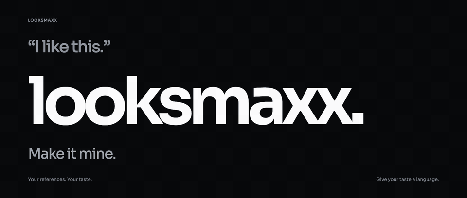
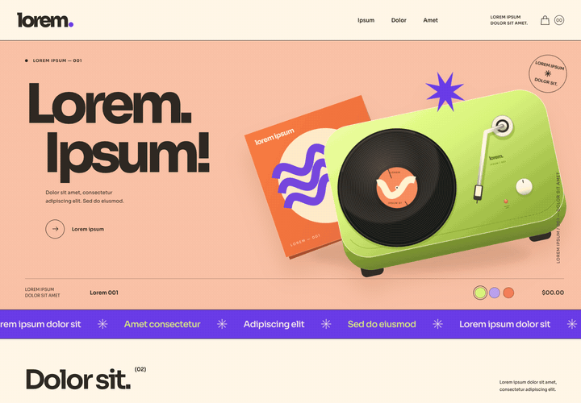
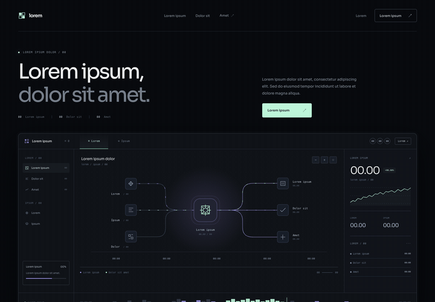
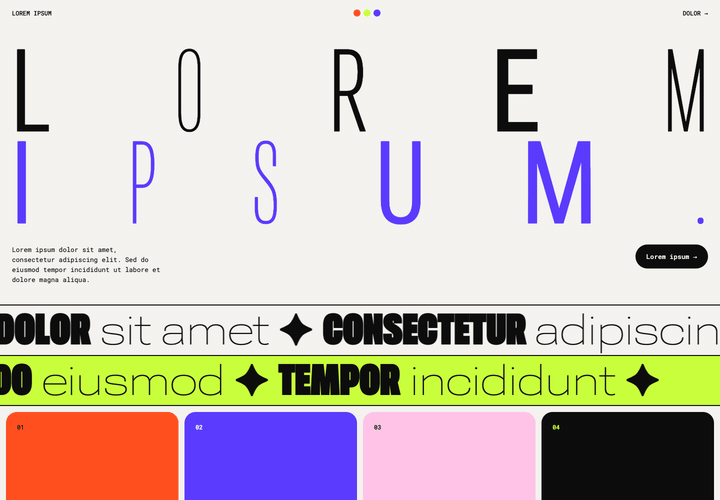
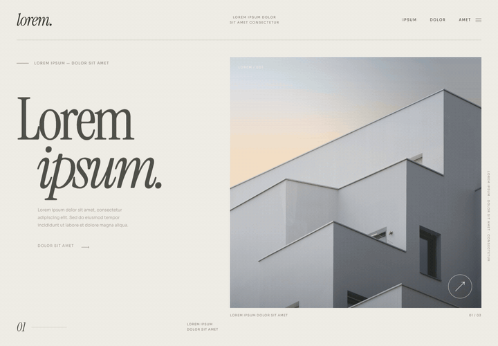

<picture>
  <source media="(prefers-reduced-motion: reduce)" srcset="assets/readme-header.png">
  
</picture>

# looksmaxx

Give your agent a few sites you like, a screenshot, or a rough idea. Looksmaxx turns that into a design language in `DESIGN.md`, then builds from it.

## Install

macOS / Linux (On Windows use Git Bash or WSL):

```sh
curl -fsSL https://raw.githubusercontent.com/aravind-n/looksmaxx/main/install.sh | sh
```

## Examples

### Shop

[](assets/examples/shop.gif)

_**Playful · Tactile · Bold**: Put the objects on stage, and make browsing feel hands-on._

### Product

[](assets/examples/product.gif)

_**Precise · Instrumented · Layered**: Make a complex system legible through visible structure and state._

### Kinetic Swiss

[](assets/examples/kinetic-swiss.gif)

_**Confidence · Reactive**: Typography is the interface: large, bold, and responsive to your cursor._

### Editorial

[](assets/examples/editorial.gif)

_**Editorial · Spacious · Framed**: Give the images room, and let typography guide the reading._

## Usage

Invoke the skill in your agent:

```text
/looksmaxx build my portfolio.
I like these sites: [links].
Help me figure out what I like about them, then build with that direction.
```

Steer it in plain language: “too busy,” “more like the first one,” “this part is cool.” For the language alone, ask for `DESIGN.md` without a build.
